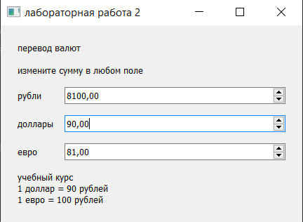

# лабораторная работа 2

основы проектирования графического интерфейса компьютерных систем

работа посвящена сигналам и слотам в pyqt5. программа переводит денежную сумму между рублями, долларами и евро. при изменении одного поля остальные значения пересчитываются автоматически.

для расчётов используются условные учебные курсы. один доллар равен 90 рублям, а один евро равен 100 рублям. текущие курсы из интернета не загружаются.

## запуск

основной файл проекта называется `lab_2.ipynb`. его нужно открыть в pycharm или jupyter и выбрать локальное ядро python. окно приложения появляется на компьютере, где запущено ядро.

зависимости можно установить из папки проекта следующей командой. выбранный python должен совпадать с интерпретатором ядра ноутбука.

```shell
python -m pip install -r requirements.txt
```

после установки нужно перезапустить ядро и выполнять ячейки сверху вниз. если зависимости уже установлены, ячейку установки можно пропустить.

в последней ячейке открывается окно конвертера. пока оно открыто, ячейка остаётся занятой обработкой событий. после закрытия окна выполнение завершается.

## работа программы

сумму можно изменить в любом поле. при вводе с клавиатуры значение применяется после нажатия enter или перехода в другое поле. стрелки рядом с числом меняют сумму сразу.

объект данных хранит сумму в рублях. введённые доллары или евро сначала переводятся в рубли, после чего рассчитываются значения остальных полей.

сигнал `valueChanged` передаёт введённое число соответствующему слоту. после расчёта объект данных отправляет собственный сигнал `changed`, а окно получает результат и обновляет поля.

на время программного обновления сигналы полей отключаются через `blockSignals`. это предотвращает повторный вызов пересчёта при обновлении связанных значений.

## работа приложения

на снимке введено 90 долларов. программа пересчитала сумму в 8100 рублей и 81 евро по учебному курсу.


